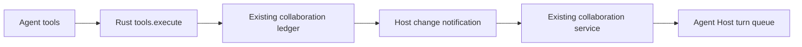
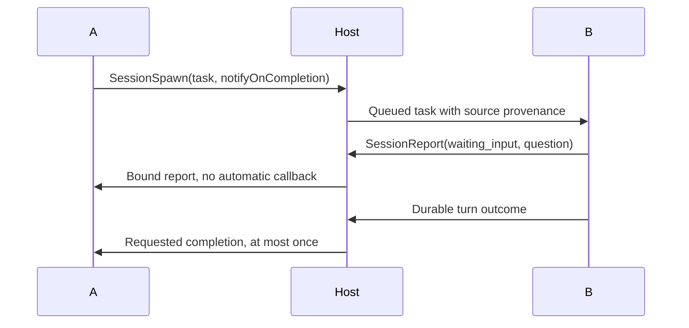

# Workspace session messaging design

## Metadata
Slug: workspace-session-messaging. Approved in this conversation. No commit or
remote publishing is authorized. Root AGENTS.md overrides skill auto-commit rules.

## Todo list
- [x] host-tools: workspace-scoped native tools and Host tests.
- [x] runtime-catalog: native tool schemas, descriptions, declaration tests.
### Checkpoint
Native tool calls validate durable source, workspace, and permission constraints.
- [x] native-dispatch: reuse existing collaboration service for Host-owned messages.
- [x] phase-reports: subscribed delivery reports and no-callback ordinary messages.
### Checkpoint
Existing plugin behavior remains compatible; native messages do not require plugins.
- [x] acceptance: integration/E2E, static checks, spec and ADR synchronization.

## Architecture
Rust owns workspace identity, transcript access, ledger, and report binding. Agent
runtime owns model-facing declarations. Electron remains a thin event/drain adapter.
The existing Agent Host owns admission, queue order, cancellation, and execution.

## Flows

## Contracts
SessionList {}; SessionRead {sessionId,before?,limit?}; SendMessage
{sessionId,content,notifyOnCompletion?}; SessionSpawn
{task,title?,notifyOnCompletion?}; SessionReport {state,content}. State is
phase_completed or waiting_input. SendMessage defaults callback off; spawn defaults
on because it establishes the initiating relationship. Tool descriptions restrict
subscriptions to explicit user intent. Reports resolve targets from the Host's
current subscribed delivery, not arbitrary caller identities. Existing plugin
contracts/defaults remain unchanged. Legacy plugin_id stores the reserved Host
owner namespace host:workspace-sessions; this is not a fabricated loaded plugin.
No database migration is planned.

## Code touch list
Host rpc/workspace_session_tools*, session_collaboration/workspace.rs, minimal RPC
and risk wiring; agent-runtime/session-tools.ts plus runtime registration;
Electron services/session-collaboration.ts and runtime/host.ts plus thin index
wiring; focused tests; domain specs, ADR, unreleased highlights.

## Testing strategy
Write Host and runtime tests first. Cover real interfaces and preserve legacy
plugin callback tests. Model and transport boundaries use deterministic fixtures.
### E2E scenarios
| ID | Scenario | Entry | Assertions |
|---|---|---|---|
| E2E-SESSION-workspace-messaging | A/B discovery, read, send, report | tools.execute | Same workspace only, requested callback targets A |
| E2E-SESSION-native-dispatch | Native ledger to target runtime | collaboration service | Busy queued, idle started, no plugin requirement |
| E2E-SESSION-independent-top-level-communication | Existing plugin compatibility | collaboration RPC | Existing behavior unchanged |

## Edge cases and errors
Unknown/deleted/foreign sessions fail closed. Null workspace is not shared.
Revalidate queued native workspace binding at execution. Stale turns, cancellation,
Host restart, plugin disable, and target movement must not raise authority or replay
execution. Keep deterministic tool-call idempotency and bounded chain/inbox limits.
Phase reports are declared events, not proof the entire task succeeded.

## Implementation order
Host validation + tests; runtime declarations + tests; existing dispatcher adapter;
regression suites, E2E, specs and review.

## Rationale
A second broker or plugin impersonation would create competing authority. Reuse
existing lifecycle and permissions. Keep busy delivery queued rather than changing
human steering provenance and durable turn uniqueness in this change.

## UI
Existing session-message origin rendering is reused. No new UI/mockups required.

## Delivery status
Implemented and validated in the dedicated uncommitted request worktree. See
verification.md for exact checks, candidate identity and limitations. The optional
independent review could not read this worktree (PATH_OUTSIDE_WORKSPACE); it did
not produce a verdict. The implementer completed the bounded diff inspection and
fixed missing per-message provenance in bounded context reads with red/green tests.
No commit, tag, push, PR, running Desktop access or paid provider call occurred.
